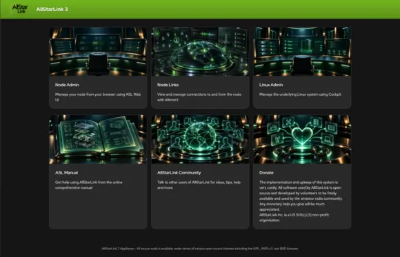

---
hide:
  - navigation
  - toc
---
# Welcome to AllStarLink

AllStarLink is a network of Amateur Radio repeaters, remote base stations and hot spots accessible to each other via Voice over Internet Protocol. AllStarLink runs on a dedicated computer that you host at your home, radio site, datacenter, or hosting provider.

{ align=right }

 AllStarLink is based on the open source Asterisk PBX running our app_rpt application. App_rpt makes Asterisk a powerful system capable of controlling one or more radios. It provides linking of these radio "nodes" to other systems of similar construction anywhere in the world via VoIP.

AllStarLink’s version 3 (ASL3) is the newest generation of AllStarLink repeater and hot spot software. The app\_rpt module, the workhorse of AllStarLink tracks the current release of Asterisk LTS for stability and logevity. The system also always tracks Debian Linux operating system and will remain current on any platform supported by the "stable" and "oldstable" - currently Debian 13 Trixie and Debian 12 Bookworm respectively.

In general, AllStarLink will run on any x86_64/amd64 hardware device, any emulated x86_64/amd64 or arm64/aarch64 virtual machine, and supportable arm64-based devices such as Raspberry Pi and Arduino UNO Q.

## Manual Navigation

Did you see the "Next" and "Previous" buttons at the bottom of the page? Those will move you forward and back through the various pages in each manual section. At the top of the page, you will find the Navigation Bar, to let you jump to a particular section of the manual. Once you are in a section of the manual, a Table of Contents is provided on the left side of the screen, to let you quickly find the topic you are looking for.

Click the Next button on the bottom of the page to Get Started!
