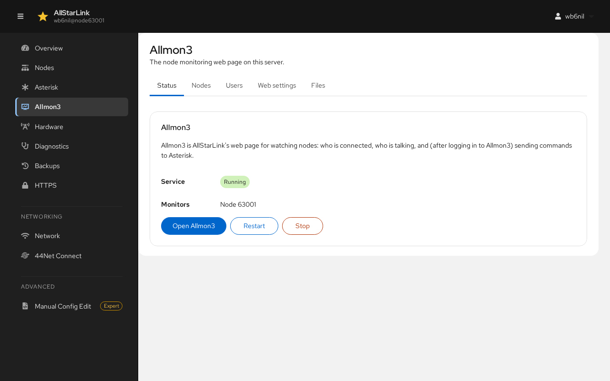
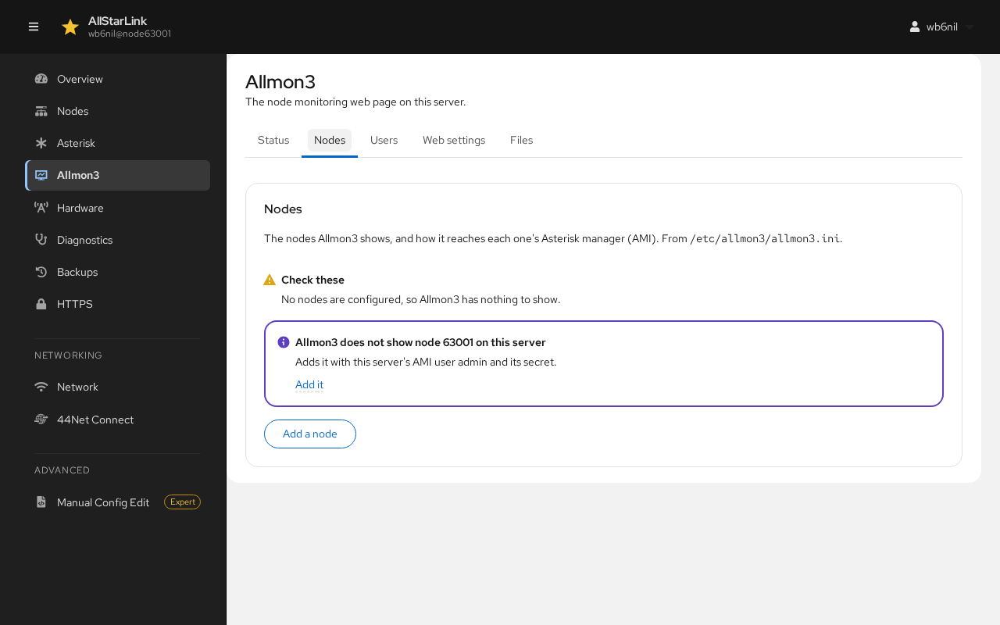
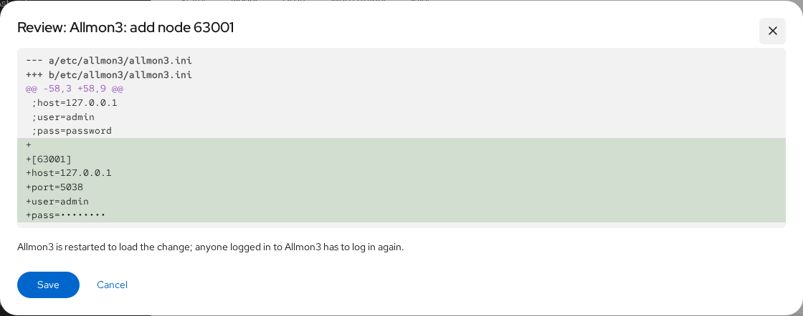
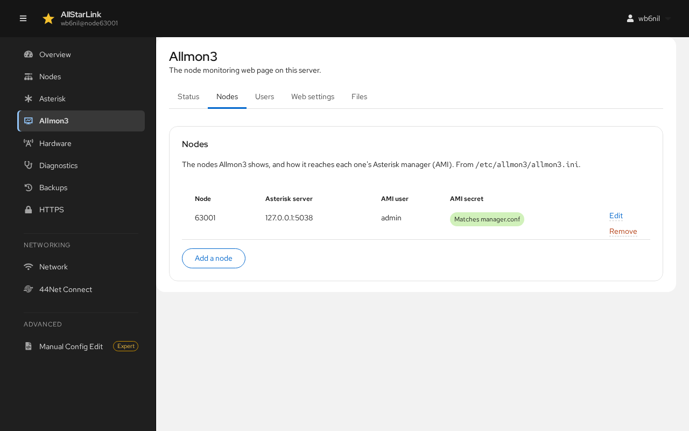
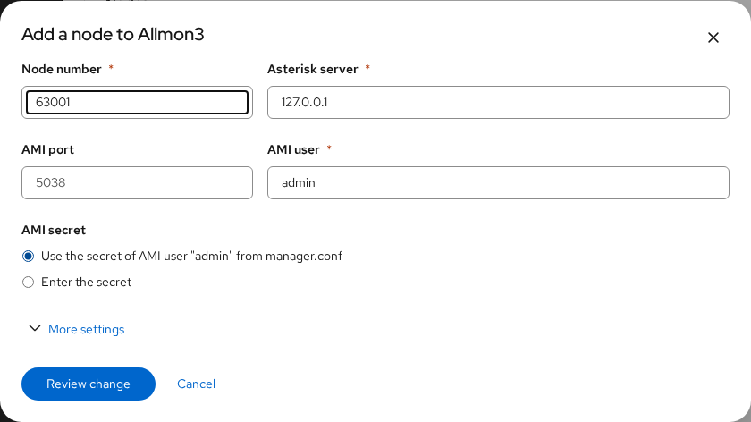
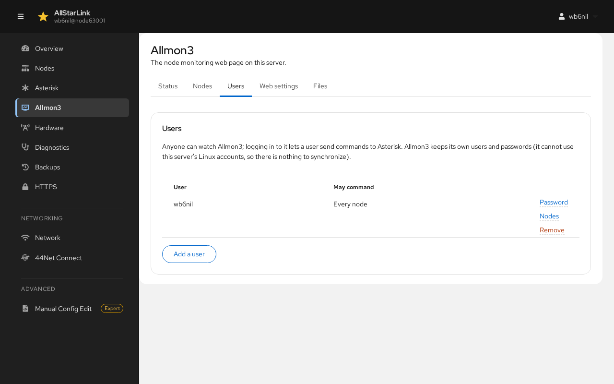
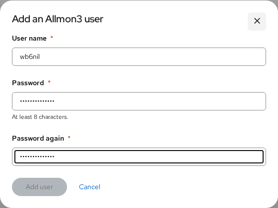
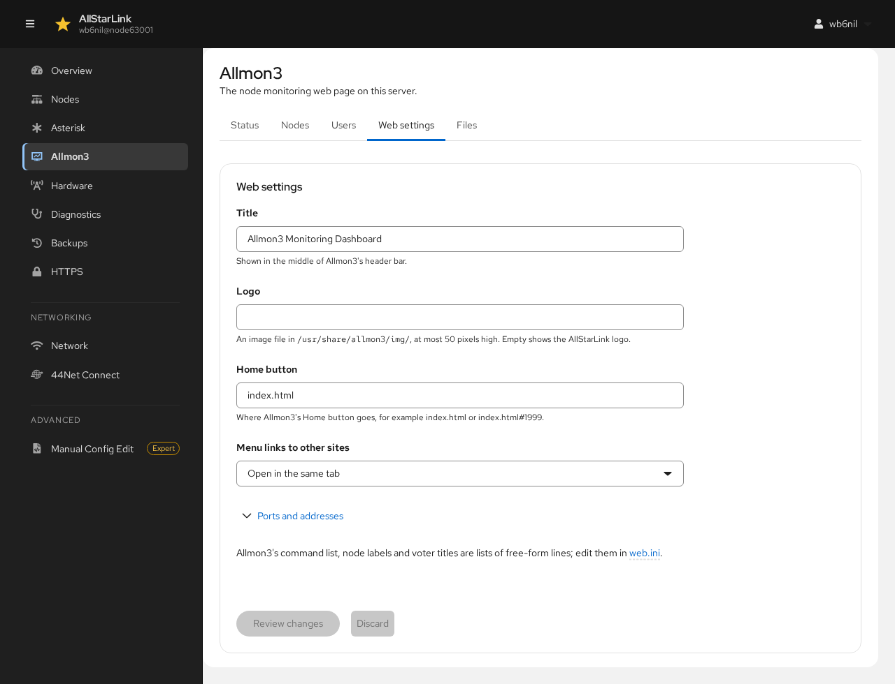
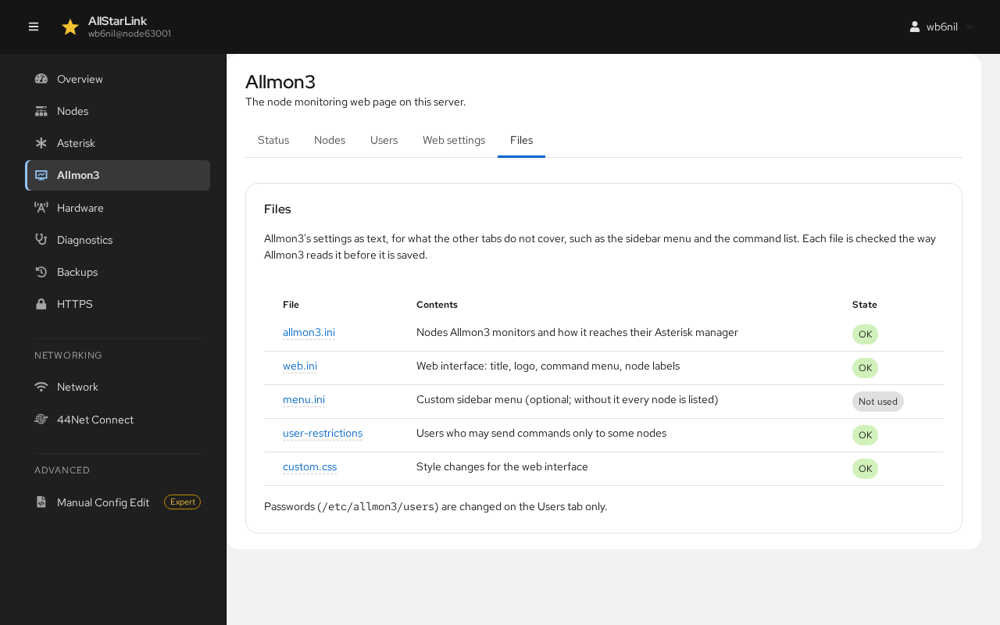
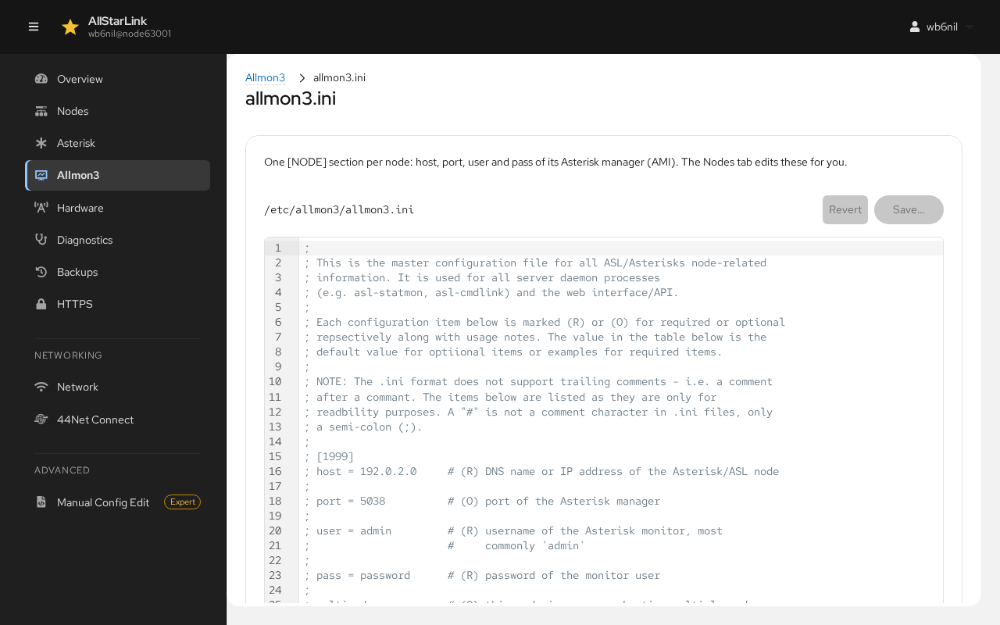

# Allmon3
The **Allmon3** page manages [Allmon3](../allmon3/index.md), AllStarLink's web page for watching nodes: who is connected, who is talking, and (after logging in to Allmon3) sending commands to Asterisk. It has five tabs: **Status**, **Nodes**, **Users**, **Web settings** and **Files**.

If Allmon3 isn't installed, the page says so. Install it with `sudo apt install allmon3`, then come back to set it up.

Every change on this page restarts Allmon3 to load it. Anyone logged in to Allmon3 has to log in again.

## Status

**Status** shows whether the Allmon3 service is running and which nodes it monitors.

* **Open Allmon3** opens Allmon3 in a new browser tab.
* **Restart** and **Stop** control the Allmon3 service; **Start** starts it again.

## Nodes
The **Nodes** tab lists the nodes Allmon3 shows, and how it reaches each one's Asterisk Manager Interface (AMI). They are kept in `/etc/allmon3/allmon3.ini`.

After a new installation, Allmon3 has no nodes. The tab offers to add each node on this server that Allmon3 doesn't show yet, using this server's AMI user `admin` and its secret:

Click **Add it**. The change is shown for review; click **Save**.

The node is now listed. **AMI secret** shows **Matches manager.conf** when Allmon3 has the same secret as Asterisk:

To monitor a node on another server, or to set the AMI details yourself, click **Add a node**:

* **Node number**: the node to show.
* **Asterisk server** and **AMI port**: where its Asterisk Manager Interface listens. Use `127.0.0.1` and `5038` for a node on this server.
* **AMI user**: usually `admin`.
* **AMI secret**: use the secret from this server's `manager.conf`, or enter the secret of the other server.
* **More settings** has Allmon3's less common per-node options.

Click **Review change**, then **Save**. Use **Edit** and **Remove** on a node's row to change or remove it.

## Users
Anyone can watch Allmon3. Logging in to Allmon3 lets a user send commands to Asterisk. Allmon3 keeps its own users and passwords; it can't use the server's Linux accounts.

Click **Add a user**, enter a **User name** and a **Password** (at least 8 characters) twice, then click **Add user**.

For each user:

* **Password** changes the user's password.
* **Nodes** limits the nodes the user may send commands to (**Every node** or **Only these nodes**). See [Allmon3 User Management](../allmon3/usermgmt.md).
* **Remove** deletes the user.

## Web Settings
**Web settings** changes how Allmon3's web page looks:

* **Title**: shown in the middle of Allmon3's header bar.
* **Logo**: an image file in `/usr/share/allmon3/img/`, at most 50 pixels high. Leave it empty for the AllStarLink logo.
* **Home button**: where Allmon3's Home button goes, for example `index.html` or `index.html#63001`.
* **Menu links to other sites**: open in the same tab or a new one.
* **Ports and addresses**: where Allmon3 listens. Change these only if you know you need to.

Click **Review changes** to save them, or **Discard** to throw them away.

## Files
**Files** lists Allmon3's settings files and whether Allmon3 can read each one. It covers what the other tabs don't, such as the sidebar menu (`menu.ini`) and the command list.

Click a file name to edit it as text. The file is checked the way Allmon3 reads it before it is saved:

Passwords (`/etc/allmon3/users`) are changed only on the **Users** tab.
