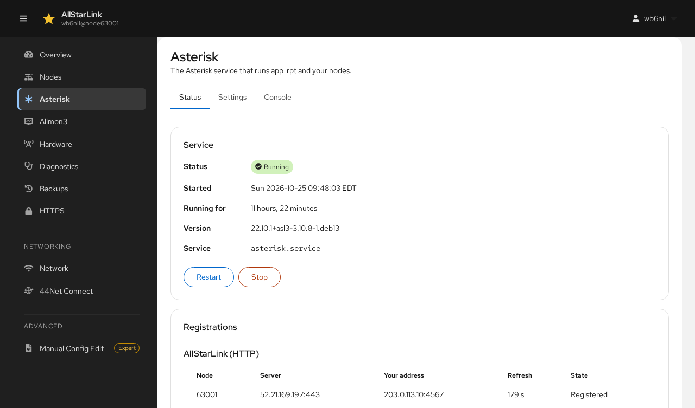
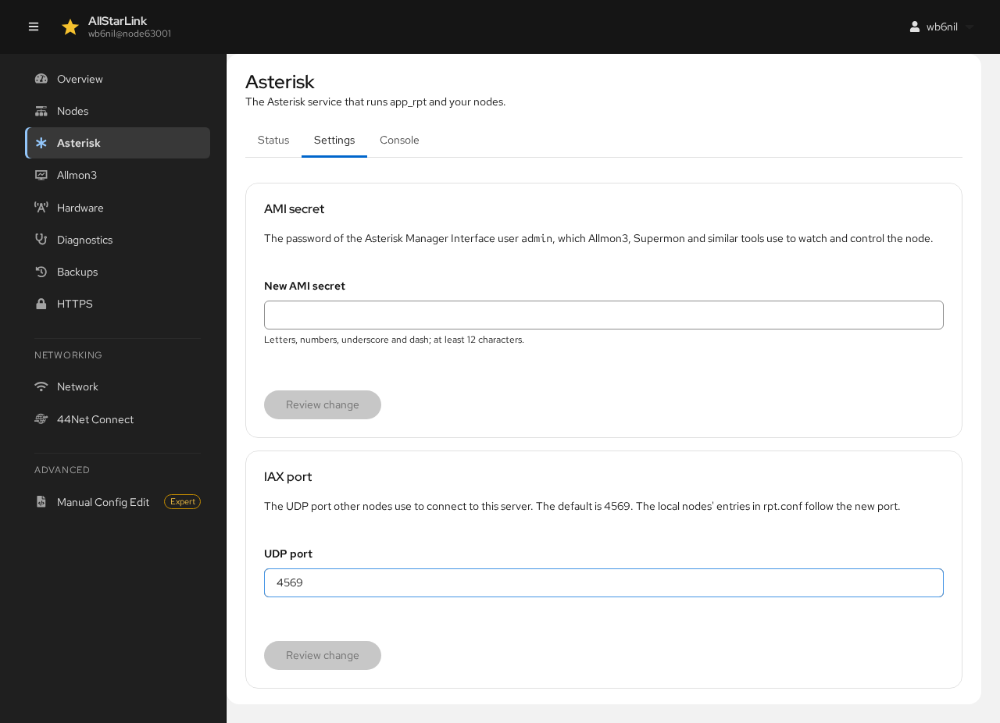
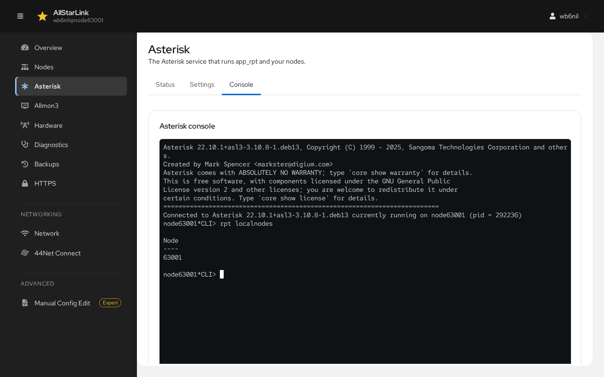

# Asterisk
The **Asterisk** page manages the Asterisk service, which runs `app_rpt` and all of your nodes. It has three tabs: **Status**, **Settings** and **Console**.

## Status

**Service** shows whether Asterisk is running, when it started, its version and the systemd service name.

* **Restart** stops and starts Asterisk, for example to load configuration changes.
* **Stop** stops Asterisk. Your nodes are off the air until you start it again with **Start**.

!!! note "Restarting Asterisk Takes Your Nodes Off the Air"
    Restarting or stopping Asterisk drops every connection to every node on the server, and runs each node's startup macro when it starts again. If `rpt.conf` has errors that would keep the nodes from starting, the ASL Web UI warns you and offers to open the file instead.

**Registrations** lists each node's registration with AllStarLink:

* **AllStarLink (HTTP)** shows each node registered over HTTP: the registration server, the address AllStarLink sees for the node, the refresh interval and the state. A working node shows **Registered**.
* **IAX2** shows registrations made with IAX instead. See [IAX Registration](../adv-topics/iaxreg.md).

A node that isn't registered can't be reached by other nodes. The [connectivity check](diagnostics.md#node-connectivity-check) helps find out why.

## Settings

### AMI Secret
The **AMI secret** is the password of the Asterisk Manager Interface user `admin`. Allmon3, Supermon and similar tools use it to watch and control the node. Enter a **New AMI secret** (letters, numbers, underscore and dash; at least 12 characters), then click **Review change**.

Only the `admin` user's secret changes. Wherever Allmon3's settings (`/etc/allmon3/allmon3.ini`) held the old secret, the new one is written there too, and Allmon3 is restarted, so it keeps working. Update any other program that uses the AMI secret, such as Supermon, yourself.

### IAX Port
The **IAX port** is the UDP port other nodes use to connect to this server. The default is `4569`. Change it only if you run more than one server behind the same public address, and forward the new port on your router. The local nodes' entries in `rpt.conf` follow the new port.

## Console
The **Console** tab is the Asterisk command line in the browser, the same as `asterisk -r` over SSH. Type a command and press Enter. For example, `rpt localnodes` lists the nodes running on the server:

The console runs Asterisk commands only. There is no system shell in the ASL Web UI. See [ASL Commands and Tools](../user-guide/asl-cmds-tools.md) for useful commands.
