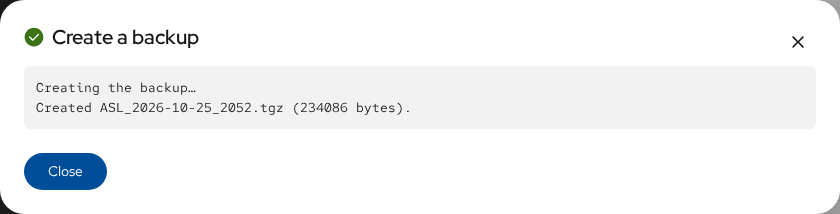
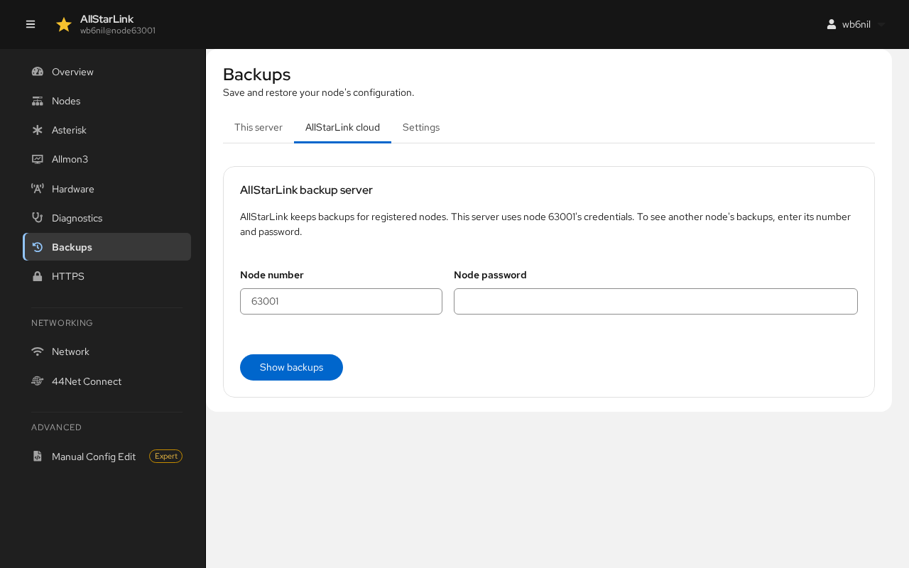
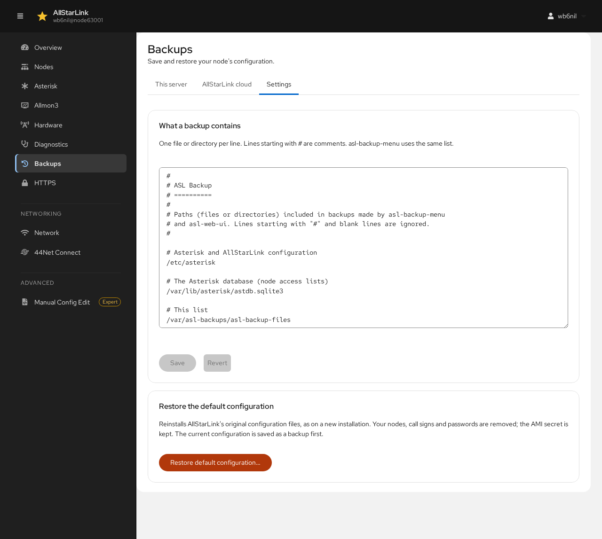

# Backups
The **Backups** page saves and restores your node's configuration. It uses the same backups, in the same place (`/var/asl-backups`) and format, as [`asl-backup-menu`](../mans/asl-backup-menu.md). It has three tabs: **This server**, **AllStarLink cloud** and **Settings**.

## This Server

### Creating a Backup
Click **Create backup**. The paths in the include list (see [Settings](#settings)) are saved in `/var/asl-backups`.

Check **Also copy it to the AllStarLink backup server** to keep a copy off the server as well. The copy is stored under the node number shown next to the checkbox, using that node's password.

### Managing Backups
**Backups on this server** lists the backups. The menu (⋮) on each row has:

* **Restore…**: restores the backup (see below).
* **Download**: saves the backup file to your computer.
* **Copy to AllStarLink**: uploads it to the AllStarLink backup server.
* **Delete…**: deletes it.

**Add a backup file…** uploads a backup from your computer, for example one made on another node, so that you can restore it.

### Restoring a Backup
Restoring writes the files from the backup over the current configuration. Before anything is written, the current configuration is saved as a new backup, so a restore can be undone. Only the paths in the include list are restored, and unsafe paths in the archive are refused.

After a restore, click **Restart Asterisk now** to load the restored configuration.

## AllStarLink Cloud
AllStarLink keeps backups for registered nodes. This server uses its node's credentials. To see another node's backups, enter its **Node number** and **Node password** (from the [AllStarLink Portal](../basics/portal.md)), then click **Show backups**.

For each backup on the AllStarLink server, **Copy to this server** downloads it to `/var/asl-backups`, and **Restore** restores it directly.

## Settings

### What a Backup Contains
The include list has one file or directory per line. Lines starting with `#` are comments. By default it includes `/etc/asterisk`, the Asterisk database with the nodes' access lists (`/var/lib/asterisk/astdb.sqlite3`) and the list itself. Add other paths you want backed up, such as custom sound files, then click **Save**. `asl-backup-menu` uses the same list.

### Restore the Default Configuration
**Restore default configuration…** reinstalls AllStarLink's original configuration files, as on a new installation. Your nodes, call signs and passwords are removed; the AMI secret is kept. The current configuration is saved as a backup first.

Afterwards the server has the sample node `1999` again; see [Setting Up Your First Node](first-setup.md).
