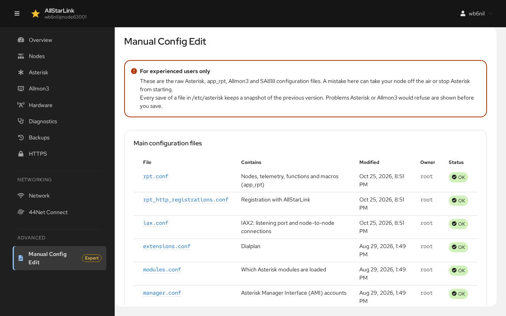
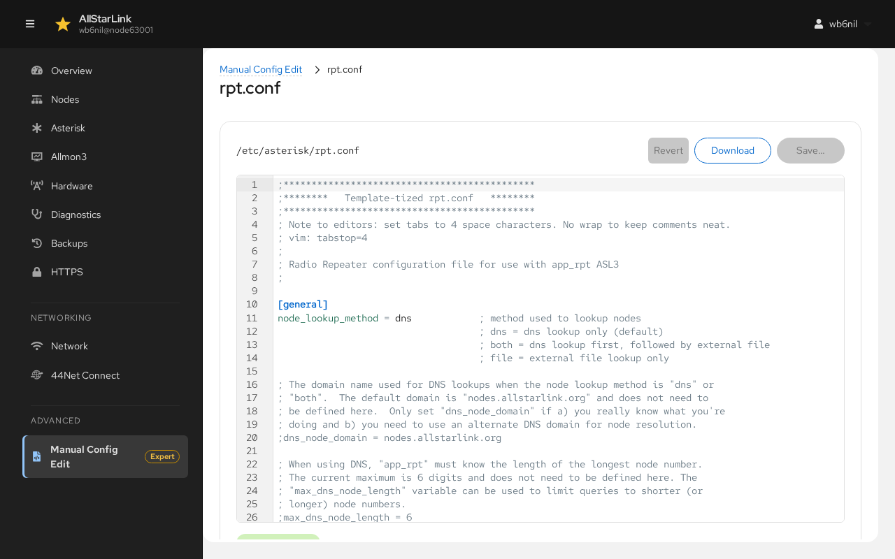

# Manual Config Edit
**Manual Config Edit**, under **Advanced** in the navigation and marked **Expert**, edits the raw Asterisk, `app_rpt`, Allmon3 and SA818 configuration files. Use the other pages whenever they cover what you need; this page is for everything else.

!!! danger "For Experienced Users Only"
    A mistake here can take your node off the air or stop Asterisk from starting. Every save of a file in `/etc/asterisk` keeps a snapshot of the previous version, and problems that Asterisk or Allmon3 would refuse are shown before you save.

## Main Configuration Files
The first table lists the main AllStarLink configuration files (`rpt.conf`, `rpt_http_registrations.conf`, `iax.conf`, `extensions.conf`, `modules.conf`, `manager.conf`, `echolink.conf`, `usbradio.conf`, `simpleusb.conf`, `voter.conf` and `savenode.conf`), with what each one contains, when it was last changed, its owner and its **Status**: **OK**, or the number of problems found in it. See [Config Files](../config/index.md) for what goes in each one.

## All Files
**All files** lists every file, in three tabs:

* **/etc/asterisk**: all of Asterisk's files. **Filter by name** narrows the list.
* **/etc/allmon3**: Allmon3's files. The [Allmon3](allmon3.md) page covers most of them.
* **SA818**: `/etc/sa818.conf`. The [Hardware](hardware.md) page covers it.

## Editing a File
Click a file name to open it in the editor:

* The editor highlights the syntax and marks problems on the lines where they are found, checking the file the way Asterisk reads it: a section header missing its `]`, a template that isn't defined, an `#include` whose file doesn't exist, a line without `=` that Asterisk ignores, a block comment that is never closed, and similar.
* **Save** shows the changes for review before writing the file.
* **Revert** throws away your edits.
* **Download** saves the file to your computer.

Most changes take effect only when Asterisk restarts. Use the banner at the top of the page.

!!! note "Files Edited Elsewhere"
    The ASL Web UI reads the files fresh each time. You can edit them over SSH, with the ASL3 Menu or here, as you like. If a file changes on disk while it is open in the editor, the editor warns you, and nothing is written over the other change.

If a file in `/etc/asterisk` is owned by another user, for example after it was edited as `root`, the ASL Web UI can't change it. The editor says so and offers **Fix permissions**.
