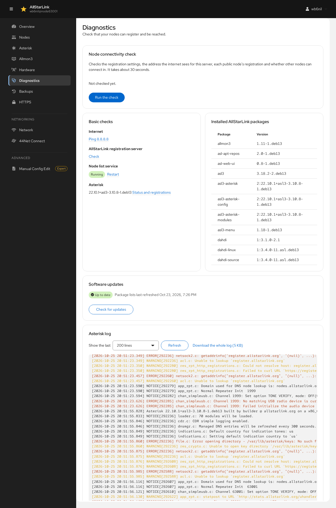
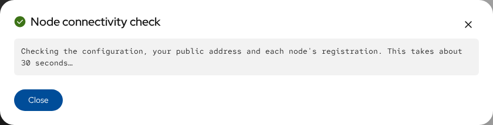
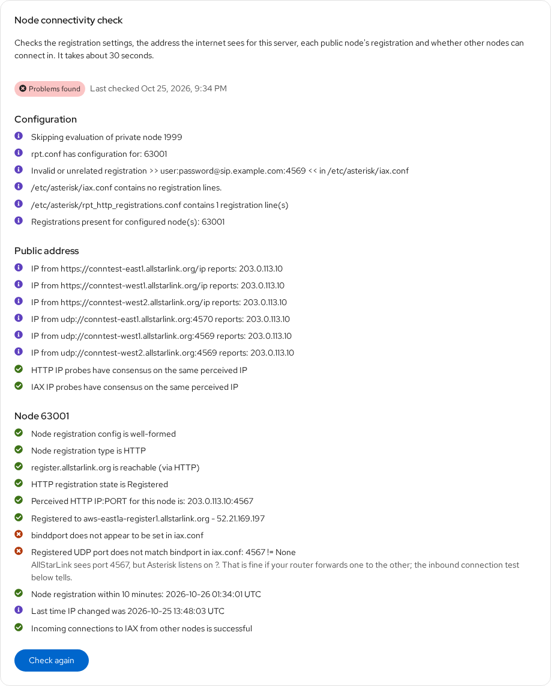

# Diagnostics
The **Diagnostics** page checks that your nodes can register with AllStarLink and be reached by other nodes, and shows what is installed and what Asterisk has logged.

## Node Connectivity Check
The node connectivity check runs `asl-node-auth-check`. It checks:

* The registration settings in the configuration files.
* The address the internet sees for this server.
* Each public node's registration.
* Whether other nodes can connect in.

Click **Run the check**. It takes about 30 seconds:

The result stays on the page, with the time it was made, until you click **Check again**. It is grouped into the configuration, the public address and each node:

Green marks are fine, blue ones are information, and red ones are problems to look at, with an explanation where there is one. In this example the node is registered and other nodes can connect in. The two problems are about the IAX port: AllStarLink sees the node on port 4567, but `iax.conf` doesn't set `bindport`, so the check can't tell which port Asterisk listens on. That is fine as long as the router forwards one to the other, and the last line confirms that incoming connections work. The line about an "invalid or unrelated registration" is a VoIP-provider registration in `iax.conf` that has nothing to do with AllStarLink. **Full output** shows everything `asl-node-auth-check` printed.

The [Overview](overview.md) page also shows the result of the last check.

## Basic Checks
* **Internet**: **Ping 8.8.8.8** checks that the server can reach the internet.
* **AllStarLink registration server**: **Check** checks that the registration server can be reached.
* **Node list service**: whether `asl3-update-nodelist`, which keeps the list of other nodes' addresses up to date, is running. **Restart** restarts it.
* **Asterisk**: the version, with a link to the [Asterisk](asterisk.md) status and registrations.

On servers that still have the DAHDI kernel modules installed, **Uninstall…** removes them. AllStarLink no longer needs them, and they are rebuilt, often unsuccessfully, on every kernel update.

## Installed AllStarLink Packages
The versions of the installed AllStarLink packages. Include this list when you [ask for support](../user-guide/support.md).

## Software Updates
**Software updates** shows whether package updates are waiting, from the last time the package lists were refreshed. **Check for updates** refreshes them. The ASL Web UI doesn't install updates itself; it links to Cockpit's Software Updates page, which opens in a new tab. See [Updates](../user-guide/updates.md).

## Asterisk Log
The end of Asterisk's log, `/var/log/asterisk/messages.log`. Warnings and errors are highlighted. Choose how many lines to **Show**, click **Refresh** to reload it, or **Download the whole log**.
