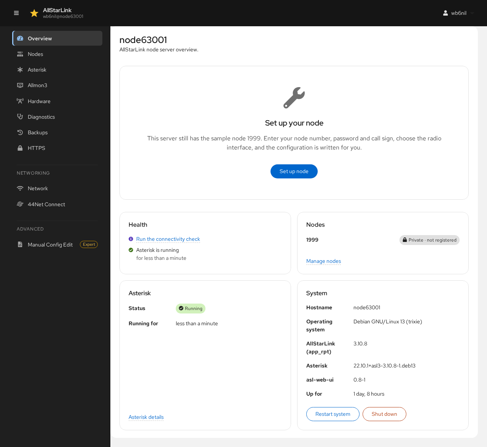
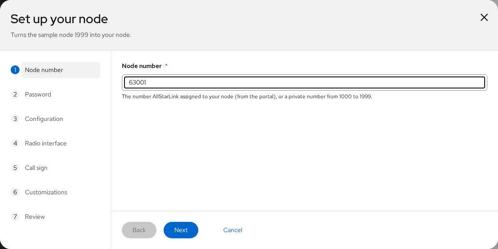
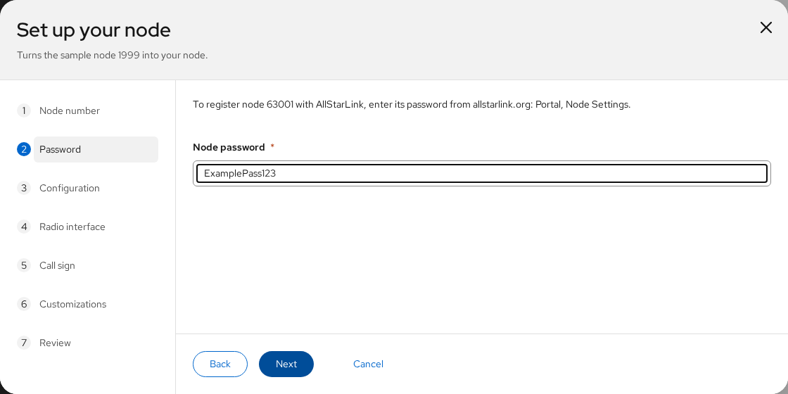
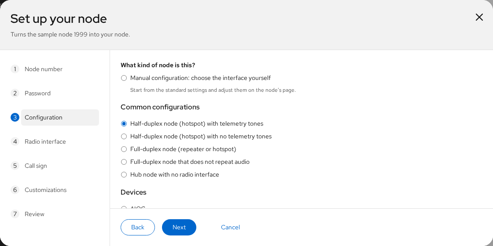
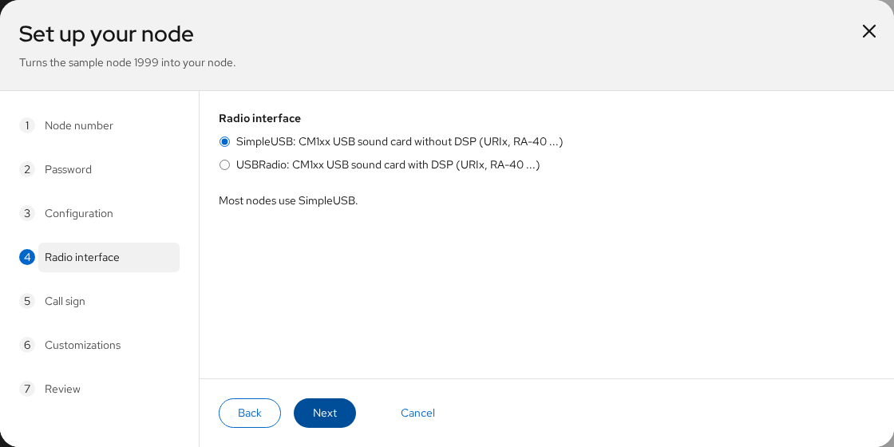
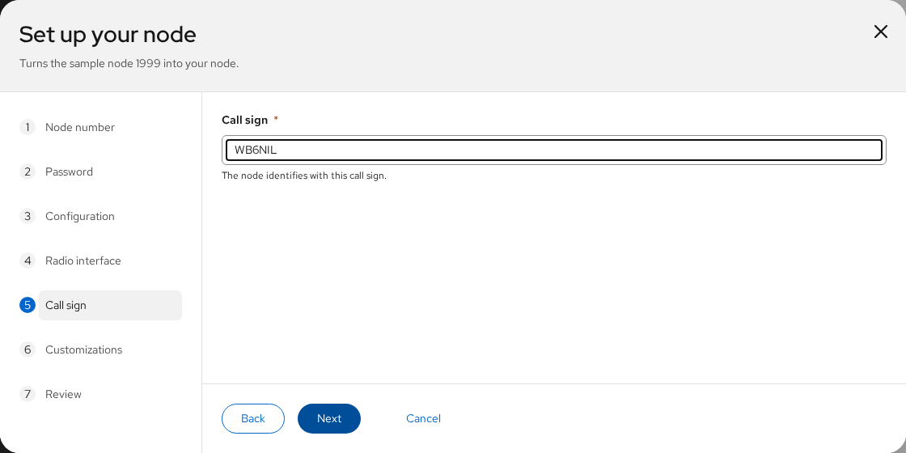
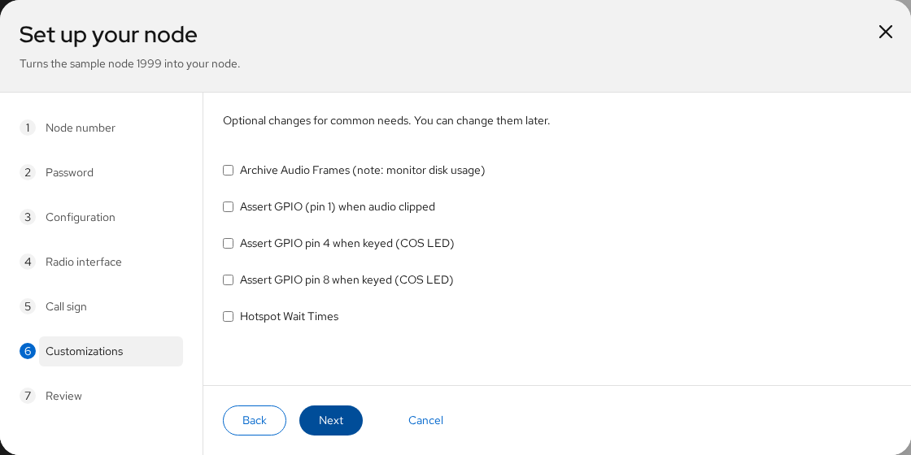
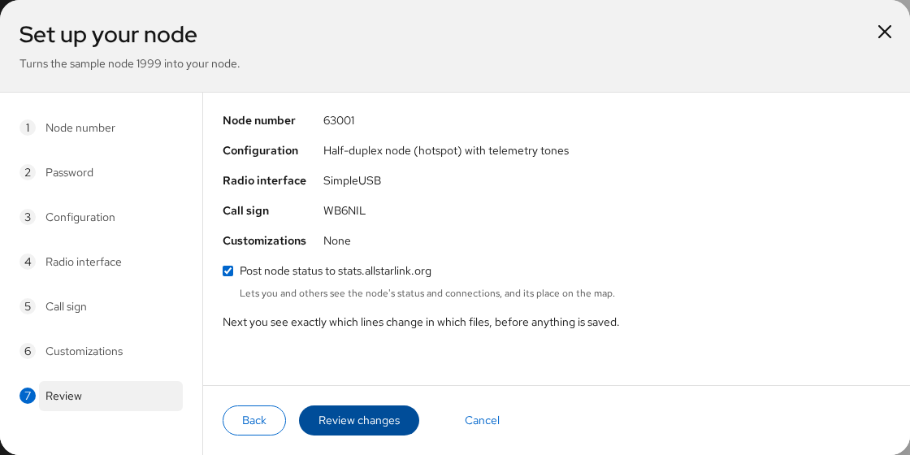
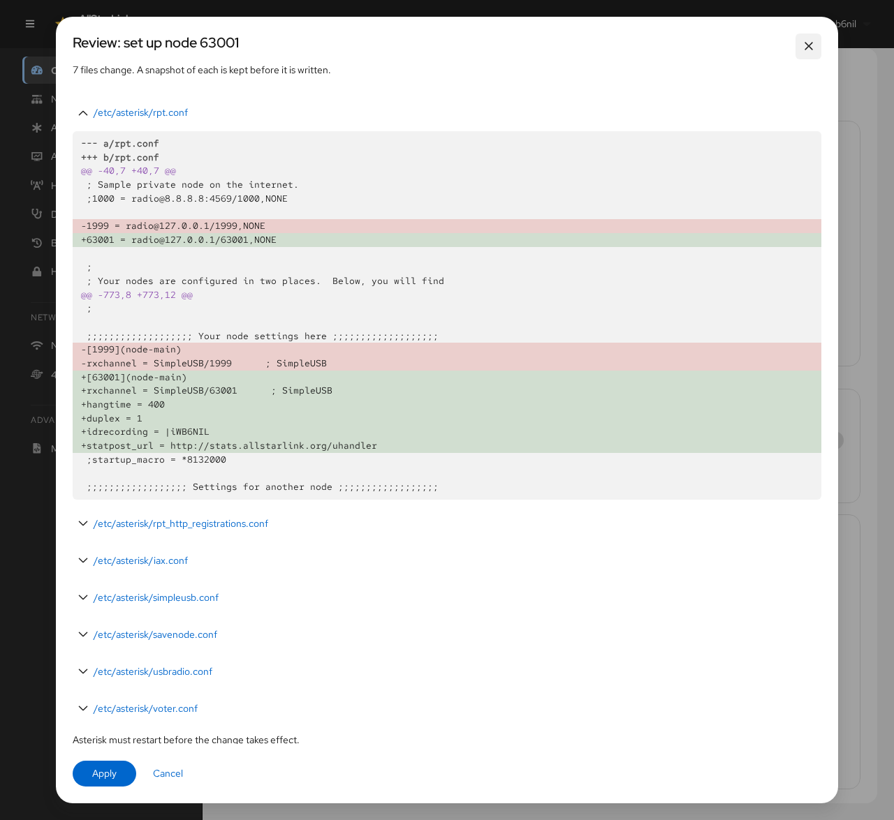

# Setting Up Your First Node
A new AllStarLink installation contains the sample private node `1999`. Until it is replaced with your own node, the [Overview](overview.md) page shows a **Set up your node** panel:

Before you start, have the following ready:

* Your **node number** and **node password** from the [AllStarLink Portal](../basics/portal.md) (*Portal* → *Node Settings*). A private node (1000–1999) doesn't need a password.
* Your **call sign**.
* The kind of **radio interface** the node uses, for example a URI or another CM1xx USB sound card.

Click **Set up node**. A step-by-step wizard opens. Nothing is saved until the last step.

## 1. Node Number
Enter your node number.

Click **Next**.

## 2. Password
Enter the node password from the AllStarLink Portal. It is used to register the node with AllStarLink. This step is skipped for private nodes.

## 3. Configuration
Choose what kind of node this is:

* **Manual configuration** starts from the standard settings. You choose the radio interface in the next step and adjust the rest later on the node's page.
* **Common configurations** set the duplex mode and telemetry for the most common types of node: half-duplex hotspots with or without telemetry tones, full-duplex repeaters, and hubs with no radio.
* **Devices** are presets for specific commercial node hardware (AIOC, HotSpotRadio, SHARI and others). They set the radio interface and its settings for you.

The example node `63001` is a half-duplex hotspot with telemetry tones.

## 4. Radio Interface
Choose the radio interface, if the configuration you chose doesn't set it:

* **SimpleUSB** for a CM1xx USB sound card (URIx, RA-40 and similar) without DSP. Most nodes use SimpleUSB.
* **USBRadio** for the same sound cards with DSP processing.

## 5. Call Sign
Enter the call sign the node identifies with.

## 6. Customizations
Optionally choose ready-made changes for common needs, such as GPIO pins for a COS LED or the hotspot wait times. You can change these later on the node's [Customizations](nodes.md#customizations) tab.

## 7. Review
Check the summary. **Post node status to stats.allstarlink.org** lets you and others see the node's status, connections and its place on the AllStarLink map; leave it checked unless you have a reason not to.

Click **Review changes**.

## 8. Review the Changes
The ASL Web UI shows every line that will change, in every file. Here node `1999` is renamed to `63001` in `rpt.conf`, and the matching changes are made in the registration, IAX and interface files:

Click **Apply** to write the files, or **Cancel** to go back.

## 9. Restart Asterisk
The new node becomes active when Asterisk restarts. A banner at the top of the page lists the changed files:

Click **Restart Asterisk**. After a few seconds the node is running. The [Overview](overview.md) and [Nodes](nodes.md) pages show it, and **Registered** once AllStarLink accepts its registration.

## Next Steps
* [Tune the radio interface](tuning.md) so the receive and transmit audio levels are right.
* Check that the node can register and be reached with the [connectivity check](diagnostics.md#node-connectivity-check).
* Let [Allmon3](allmon3.md) monitor the node.
* [Get a trusted HTTPS certificate](https.md) for the node.
