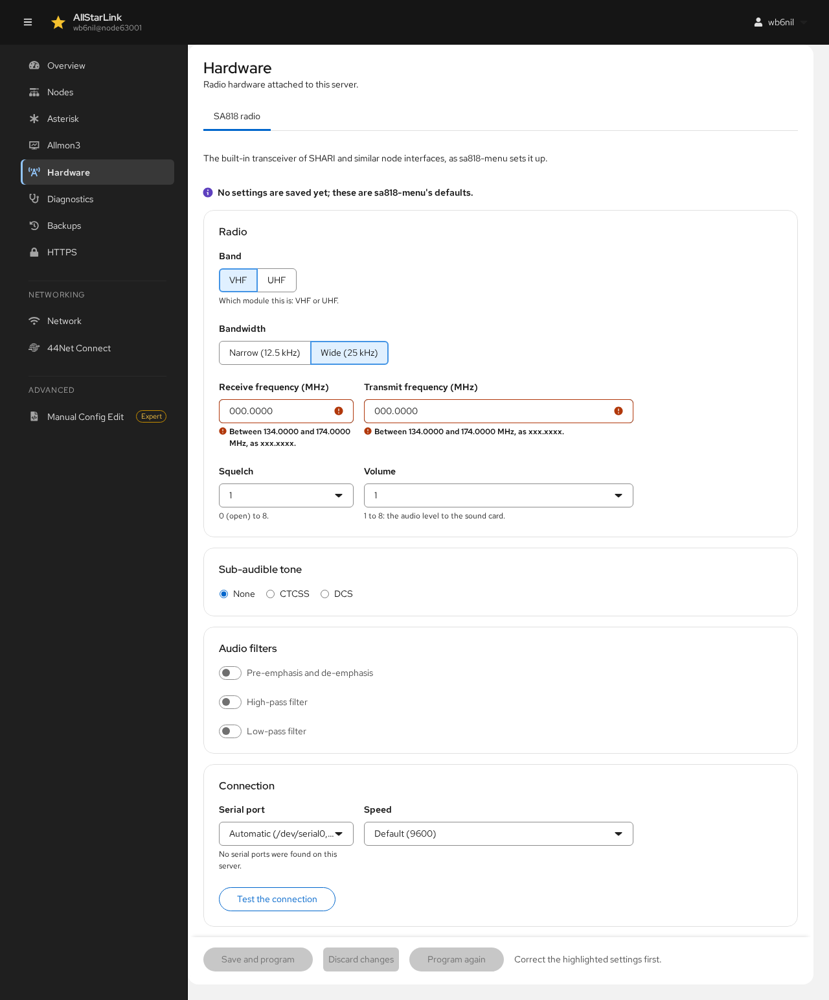

# Hardware (SA818)
The **Hardware** page sets up radio hardware attached to the server. Its **SA818 radio** tab programs the SA818 (or DRA818) transceiver module built into the SHARI and similar node interfaces. It does the same job as `sa818-menu` and uses the same settings file, `/etc/sa818.conf`. See [SA818 Modules](../adv-topics/sa818modules.md) for background.

Until settings are saved, the page shows `sa818-menu`'s defaults.

## Radio
* **Band**: whether the module is the **VHF** or **UHF** version.
* **Bandwidth**: **Narrow (12.5 kHz)** or **Wide (25 kHz)**.
* **Receive frequency (MHz)** and **Transmit frequency (MHz)**: within the module's band (for example 134.0000–174.0000 MHz for VHF), in the form `xxx.xxxx`.
* **Squelch**: from 0 (open) to 8.
* **Volume**: from 1 to 8, the audio level to the sound card.

## Sub-Audible Tone
Choose **None**, **CTCSS** or **DCS**, then the tone or code. With CTCSS, **CTCSS reverse burst (tail tone)** can be **Closed** (`sa818-menu`'s default) or **Opened**.

## Audio Filters
Turn the module's **Pre-emphasis and de-emphasis**, **High-pass filter** and **Low-pass filter** on or off.

## Connection
* **Serial port**: the port the module is connected to. **Automatic** tries `/dev/serial0`, then `/dev/ttyUSB0`.
* **Speed**: the serial speed; the default is 9600.

**Test the connection** checks that the module answers, without changing it.

## Saving
* **Save and program** saves the settings and programs them into the module.
* **Discard changes** goes back to the saved settings.
* **Program again** sends the saved settings to the module again, for example after replacing it.

The module's settings are separate from the node's audio levels. Set those on the node's [Tuning](tuning.md) tab.
