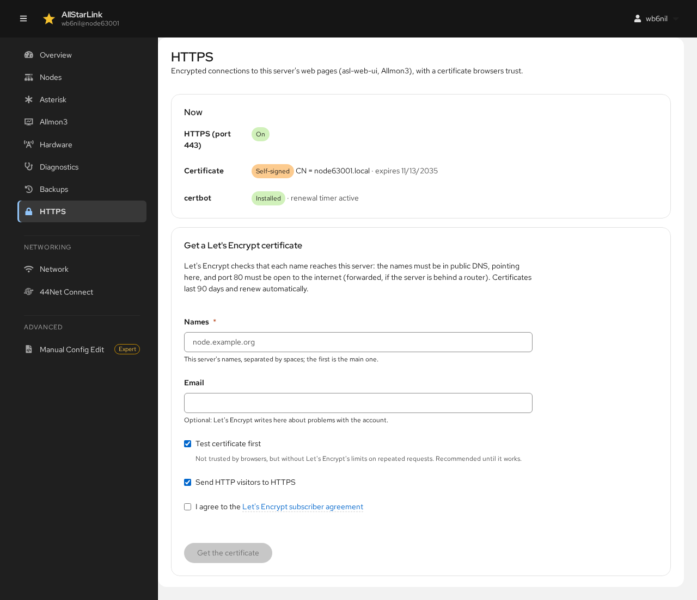

# HTTPS
The **HTTPS** page gets a free certificate from [Let's Encrypt](https://letsencrypt.org/) for the server's web pages: the ASL Web UI, Allmon3 and, if it is installed, Cockpit. With a Let's Encrypt certificate, browsers no longer show security warnings. See [Allmon3 HTTPS](../allmon3/https.md) for the background.

This page manages Apache. If the server uses nginx instead, the page says so; get a certificate with `sudo apt install python3-certbot-nginx` and `sudo certbot --nginx`.

## Now
The first section shows the current state:

* **HTTPS (port 443)**: whether Apache serves HTTPS. If it doesn't, a link enables it with Apache's self-signed certificate.
* **Certificate**: the certificate browsers are given now, and whether it is the Let's Encrypt one. A new ASL3 Appliance has a **Self-signed** certificate for its `.local` name.
* **Cockpit (port 9090)**: whether Cockpit uses the same certificate.
* **certbot**: whether the Let's Encrypt client is installed, and its renewal timer. **Install python3-certbot-apache** installs it.

## Getting a Let's Encrypt Certificate
Let's Encrypt checks that each name reaches this server, so before you start:

* The names must be in public DNS, pointing to this server.
* ***Port 80 must be open to the internet*** (forwarded on your router, if the server is behind one).

Then fill in the form:

* **Names**: the server's DNS names, for example `node63001.example.net`.
* **Email**: where Let's Encrypt sends notices about the certificate. Optional.
* **Test certificate first**: gets a test certificate that browsers don't trust, but without Let's Encrypt's limits on repeated requests. Leave it checked until it works, then clear it and get the real certificate.
* **Send HTTP visitors to HTTPS**: redirects `http://` addresses to `https://`.
* **I agree to the Let's Encrypt subscriber agreement**: required.

Click **Get the certificate**. Certificates last 90 days and renew automatically.

## Managing the Certificate
Once the server has a Let's Encrypt certificate, this section shows it and whether browsers trust it.

* The **Send HTTP visitors to HTTPS** switch turns the redirect on or off.
* **Test the renewal** checks that automatic renewal will work.
* **Stop using it** goes back to the self-signed certificate. You can also delete the certificate and stop renewing it.

If Cockpit is installed, it gets a copy of the certificate in `/etc/cockpit/ws-certs.d`, renewed with it.

!!! note "ASL3 Appliance"
    On the ASL3 Appliance, the appliance's own configuration provides Apache's sites and the redirect to HTTPS. The ASL Web UI only gives its HTTPS site the certificate.
