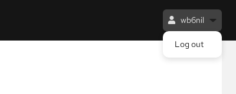
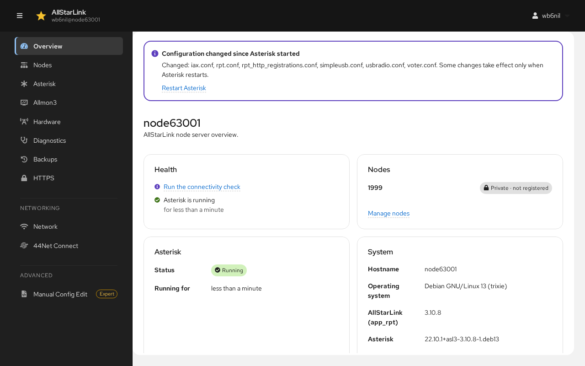

# ASL Web UI
The ASL Web UI (package `asl-web-ui`) manages an AllStarLink 3 node server from a web browser. It looks and works like the [Cockpit](../pi/index.md) web console and covers nearly everything the text-based [ASL3 Menu](../user-guide/menu.md) does: setting up nodes, tuning radio interfaces, managing Asterisk and Allmon3, backups, diagnostics and more.

!!! warning "Under Development"
    The ASL Web UI is under active development and is currently available only from the AllStarLink `devel` package repository. Don't run it on a node you can't easily fix or rebuild if something goes wrong.

## What the ASL Web UI Does
* **Node configuration**: set up a new node, add more nodes, and change the call sign, duplex, password, radio interface and other common settings. SimpleUSB, USBRadio, hub (pseudo), USRP and Voter/RTCM nodes are supported, along with "customizations" for common commercial node hardware.
* **Radio interface tuning**: adjust receive and transmit levels for SimpleUSB and USBRadio interfaces with live meters, in place of the text tune menus.
* **Access control**: allow or block other nodes from connecting to yours.
* **Asterisk management**: start, stop and restart Asterisk, see registrations, change the AMI secret and IAX port, and use the Asterisk CLI in the browser.
* **Allmon3 management**: the nodes Allmon3 monitors, Allmon3 users, and the web settings.
* **SA818 radio modules**: program the radio module built into SHARI and similar node interfaces.
* **Diagnostics**: the node connectivity check (`asl-node-auth-check`), basic network checks, installed packages, software updates and the Asterisk log.
* **Backups**: create, download, upload and restore backups on the server and from the AllStarLink cloud backup server.
* **HTTPS**: a free Let's Encrypt certificate so browsers don't show security warnings.
* **Networking**: the server's network connections and, on the ASL3 appliance, the fallback Wi-Fi access point and [44Net Connect](../adv-topics/44net-connect.md).
* **Manual Config Edit**: an editor with a syntax checker for the files in `/etc/asterisk` and `/etc/allmon3`, for experienced users.

The ASL Web UI works on the same files as the ASL3 Menu tools (`asl-menu`, `node-setup`, `asl-backup-menu`) and copes with files that were edited by hand, so you can switch between it, the menus and a text editor as you like.

## Finding Your Way Around
Every page shares the same layout:

* **The top bar** shows the server's host name and the account you are logged in with. Click the account name to log out.

    

* **The navigation column** on the left lists the pages. On a phone or a narrow window, the menu button (☰) at the top left opens it.
* **The page itself** is on the right. Many pages have tabs across the top.

## How Changes Are Made
The ASL Web UI never writes a configuration file without showing you exactly what will change. When you save, a **Review** window shows the lines removed (red) and added (green) in each file:

Click **Apply** to write the change or **Cancel** to go back. Before any file is written, a copy of it is kept, and the last 50 changes are saved in `/var/lib/asl-web-ui/snapshots`. Every change is also recorded, with who made it and when, in `/var/lib/asl-web-ui/audit.jsonl`.

Many changes take effect only when Asterisk restarts. When files have changed since Asterisk started, a banner appears at the top of every page listing them, with a **Restart Asterisk** link:

!!! note "Restarting Asterisk Takes Your Node Off the Air"
    Restarting Asterisk disconnects every connection to every node on the server. If a restart would fail because `rpt.conf` has errors, the banner says so and offers to open the file instead.

Some actions, such as restarting or stopping Asterisk, rebooting, restoring a backup and removing a node, ask for your password again if you last entered it more than ten minutes ago.

## Sections of This Guide
* [Installing and Logging In](install.md)
* [Setting Up Your First Node](first-setup.md)
* [Overview](overview.md)
* [Nodes](nodes.md) and [Tuning a Radio Interface](tuning.md)
* [Asterisk](asterisk.md)
* [Allmon3](allmon3.md)
* [Hardware (SA818)](hardware.md)
* [Diagnostics](diagnostics.md)
* [Backups](backups.md)
* [HTTPS](https.md)
* [Network and 44Net Connect](network.md)
* [Manual Config Edit](config-edit.md)

!!! note "Examples in This Guide"
    The screenshots and examples use node number `63001`, call sign `WB6NIL` and the host name `node63001`. Use your own node number, call sign and host name.
