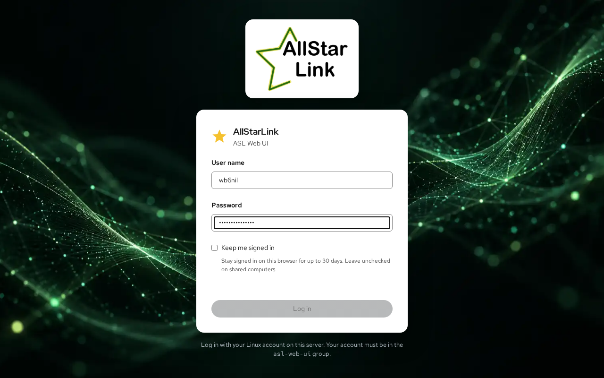

# Installing and Logging In
The ASL Web UI runs on AllStarLink 3 on Debian 13 (trixie), including the ASL3 Appliance. It is served by the node's web server (Apache or nginx) at `https://<your-node>/asl-web-ui/`.

## Installing
The ASL Web UI comes installed with the ASL3 Appliance packages (asl3-appliance) starting
with version 2.3 and no further installation is necessary.

For systems not running the ASL Appliance packages, the package is installed as follows:

```bash
sudo apt update
sudo apt install -y asl-web-ui
```

## Allowing an Account to Log In

You log in to the ASL Web UI with a Linux account on the node, the same one you use for SSH or Cockpit. The account must be a member of the `asl-web-ui` group.

!!! node "ASL Appliance is Pre-Configured"
    The ASL Appliance package is preconfigured to add all local users to the
    `asl-web-ui` group and this is unnecessary on those platforms.


If you need to add a user manually to the asl-web-ui group, you will need to do so from the Linux CLI using the following command:

```bash
sudo usermod -aG asl-web-ui <username>
```

Replace `<username>` with the account name. The `root` account can't log in.

Removing an account from the group takes effect on its next request.

## HTTPS Is Required
The ASL Web UI refuses logins over plain HTTP, because your password would cross the network unencrypted.

* **Apache:** the package enables its configuration automatically. The ASL3 Appliance and Allmon3 already serve HTTPS with a self-signed certificate.
* **nginx:** add `include /etc/asl-web-ui/nginx.conf;` inside the `server { }` block of your HTTPS site, then reload nginx.

A self-signed certificate makes the browser show a security warning. To get a trusted certificate from Let's Encrypt, use the [HTTPS](https.md) page once you have logged in.

??? note "nginx in Front of Apache"
    If nginx owns ports 80 and 443 and Apache (with the ASL Web UI) listens elsewhere, for example on port 8443 of the same machine, nginx can pass `/asl-web-ui/` through to it. Proxy to Apache over HTTPS and keep the browser's `Host` header.

    Inside `http { }`, for example in `/etc/nginx/conf.d/websocket.conf`:

    ```nginx
    map $http_upgrade $connection_upgrade {
        default upgrade;
        ''      close;
    }
    ```

    Inside the HTTPS `server { }` block:

    ```nginx
    location /asl-web-ui/ {
        proxy_pass https://127.0.0.1:8443;
        proxy_http_version 1.1;
        proxy_set_header Host $http_host;
        proxy_set_header Upgrade $http_upgrade;
        proxy_set_header Connection $connection_upgrade;
        proxy_read_timeout 1h;
        client_max_body_size 64m;
    }
    ```

## Logging In
Open `https://<your-node>/asl-web-ui/` in a web browser, where `<your-node>` is the node's host name or IP address.



Enter the account's **User name** and **Password**, then click **Log in**. Check **Keep me signed in** to stay logged in on this browser for up to 30 days; leave it unchecked on shared computers.

After you log in, the [Overview](overview.md) page opens. If the node still has the sample node `1999` from a new installation, continue with [Setting Up Your First Node](first-setup.md).

!!! note "Restarting the Service Logs Everyone Out"
    Login sessions are kept in memory. Upgrading the package or restarting the `asl-web-ui` service logs everyone out.
