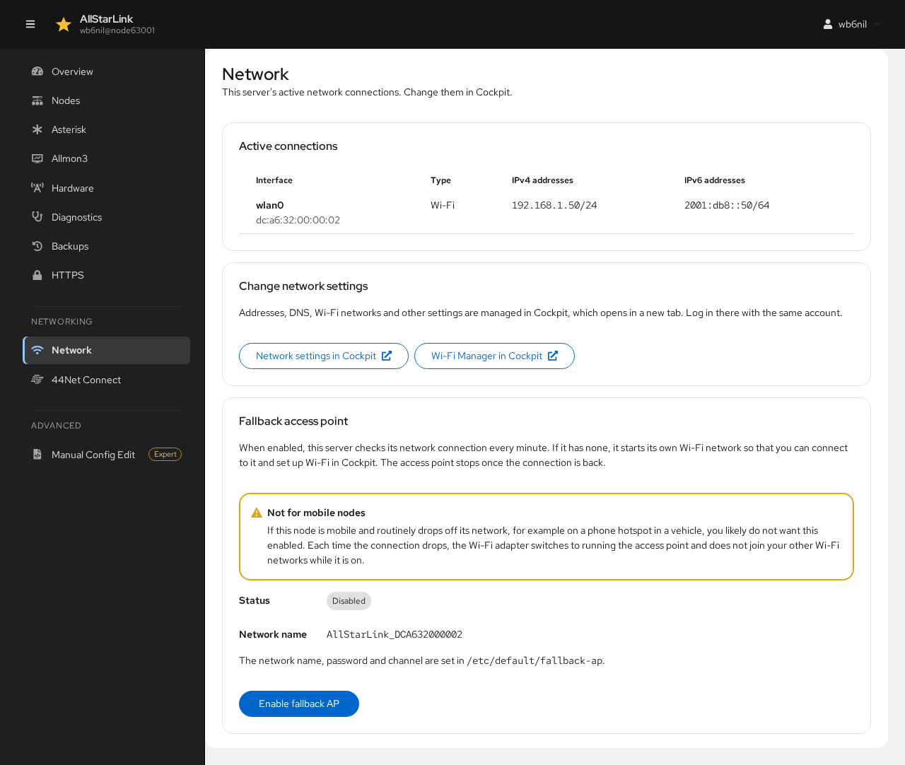
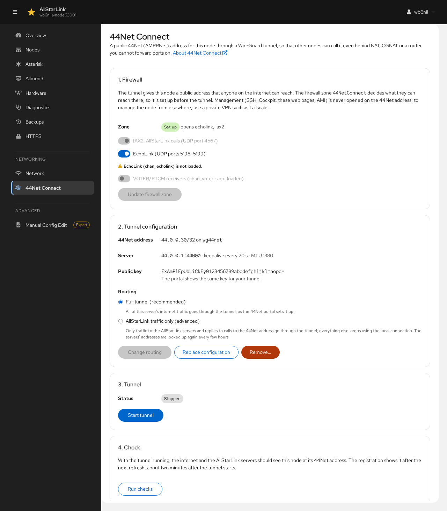

# Network and 44Net Connect
The **Networking** section of the navigation has two pages: **Network** and **44Net Connect**.

## Network
The **Network** page shows the server's active network connections, and on the ASL3 Appliance, the fallback access point.

### Active Connections
Each active connection is listed with its interface, MAC address, type (Ethernet or Wi-Fi) and IPv4 and IPv6 addresses.

### Changing Network Settings
Addresses, DNS, Wi-Fi networks and other network settings are managed in Cockpit. **Network settings in Cockpit** and **Wi-Fi Manager in Cockpit** open the matching Cockpit page in a new tab; log in there with the same account. See [Network Configuration](../pi/cockpit-network.md).

### Fallback Access Point
When the fallback access point is enabled, the server checks its network connection every minute. If it has none, it starts its own Wi-Fi network so that you can connect to it and set up Wi-Fi in Cockpit. The access point stops once the server is connected again.

The status shows whether the fallback access point is enabled, whether it is on now, and its network name (`AllStarLink_` followed by the Wi-Fi adapter's address). The network name, password and channel are set in `/etc/default/fallback-ap`. Click **Enable fallback AP** to turn it on, or **Disable fallback AP** to turn it off.

!!! warning "Not for Mobile Nodes"
    If the node is mobile and routinely drops off its network, for example on a phone hotspot in a vehicle, you likely don't want this enabled. Each time the connection drops, the Wi-Fi adapter switches to running the access point and doesn't join your other Wi-Fi networks while it is on.

The fallback access point is part of the ASL3 Appliance (`asl3-appliance-pc` and `asl3-appliance-pi`). On other systems the page says it needs the appliance.

## 44Net Connect
[44Net Connect](../adv-topics/44net-connect.md) gives the node a public 44Net (AMPRNet) address through a WireGuard tunnel, so that other nodes can connect to it even behind NAT, CGNAT or a router where you can't forward ports.

The **44Net Connect** page sets up the tunnel on the ASL3 Appliance. On other systems it says it needs the appliance. Here the tunnel is configured but not started:

Management (SSH, Cockpit, these web pages and AMI) is never opened on the 44Net address. To manage the node from elsewhere, use a private VPN such as Tailscale.

Setup has four steps:

1. **Firewall**: creates the firewalld zone `44NetConnect` for the tunnel and chooses what other nodes may reach through it: **IAX2** (AllStarLink calls, on the node's IAX port) and, optionally, **EchoLink** (UDP ports 5198–5199). If the zone no longer matches the node's settings, for example after changing the IAX port, the page warns you.
2. **Tunnel configuration**: paste the **WireGuard configuration** from the 44Net portal. The **Private key** is kept only on the server; it is never included in backups. Then choose the **Routing**:
    * **Full tunnel (recommended)**: all of the server's internet traffic goes through the tunnel.
    * **AllStarLink traffic only (advanced)**: only traffic to the AllStarLink servers goes through the tunnel. The routes are kept up to date automatically.
3. **Tunnel**: starts the tunnel. Because a broken tunnel could cut the server off the network, you must confirm that it works. If you don't confirm in time, the tunnel is stopped again.
4. **Check**: **Run checks** confirms that the node's registrations go through the tunnel.

If a 44Net tunnel was set up by hand (in `/etc/wireguard/wg0.conf`), the page shows it as **Tunnel set up by hand** and offers **Migrate this tunnel** to bring it under the page's management. Set up the firewall zone (step 1) first.

Once the tunnel is configured, step 2 shows its 44Net address, server and public key (the 44Net portal shows the same key for your tunnel), with **Change routing**, **Replace configuration** and **Remove…**, which takes the tunnel down and removes it. Step 3 has **Start tunnel** and **Stop tunnel**.
