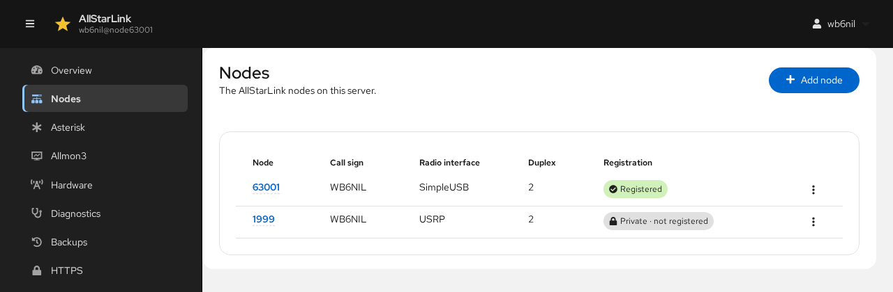
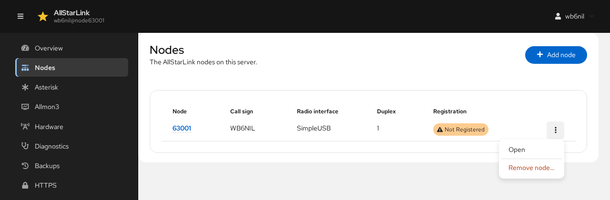
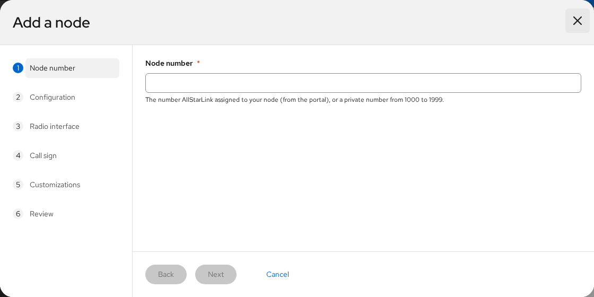
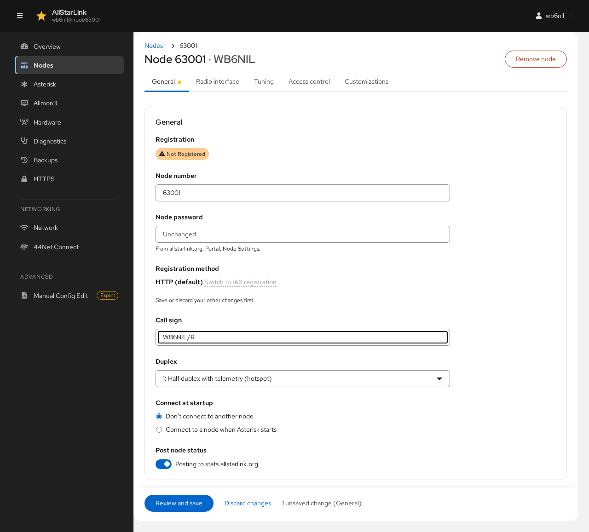
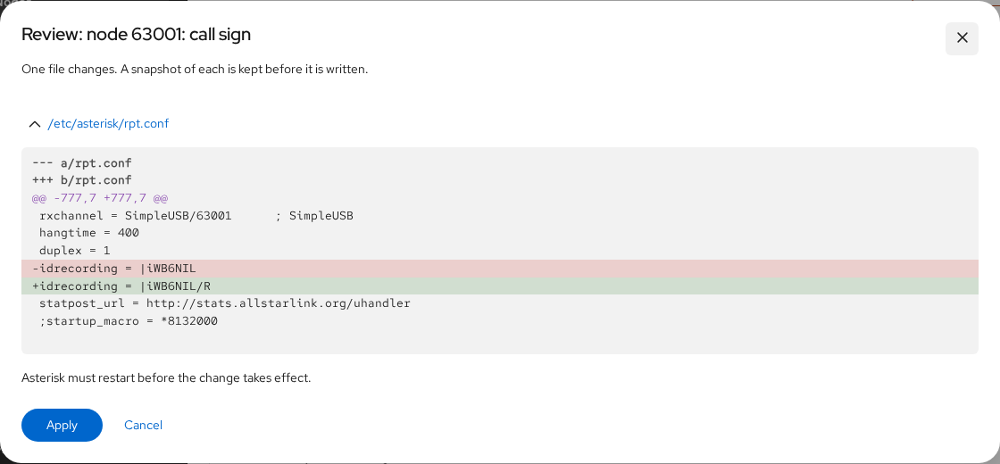
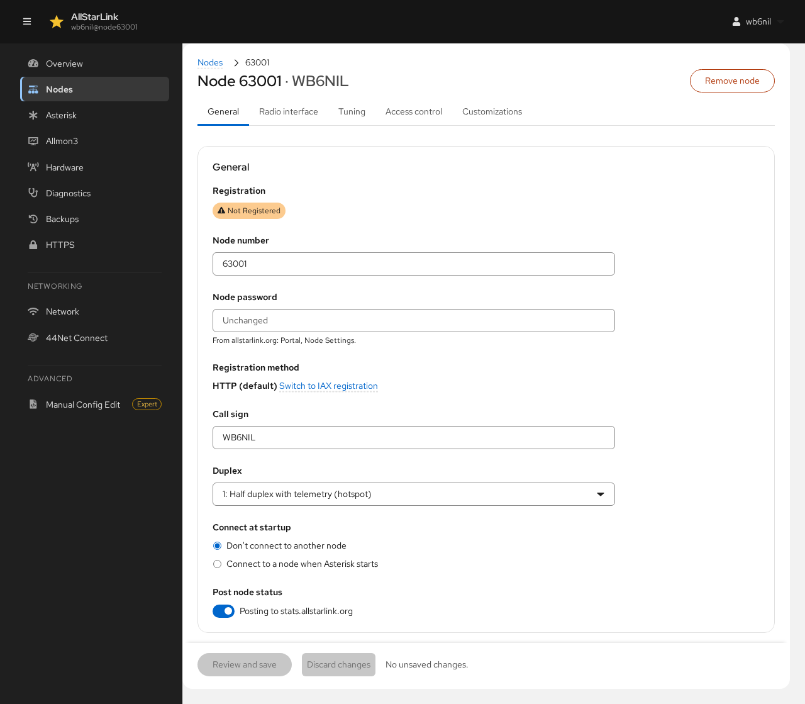
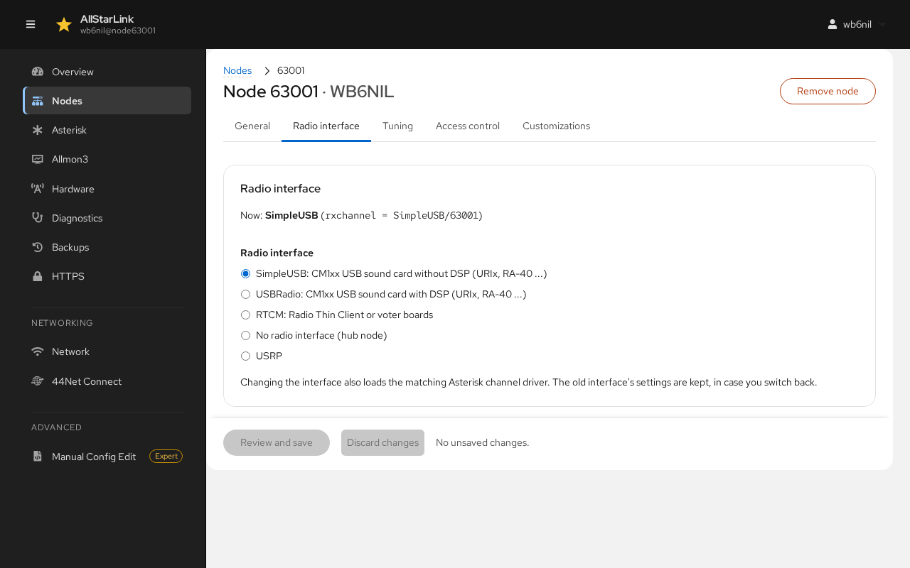
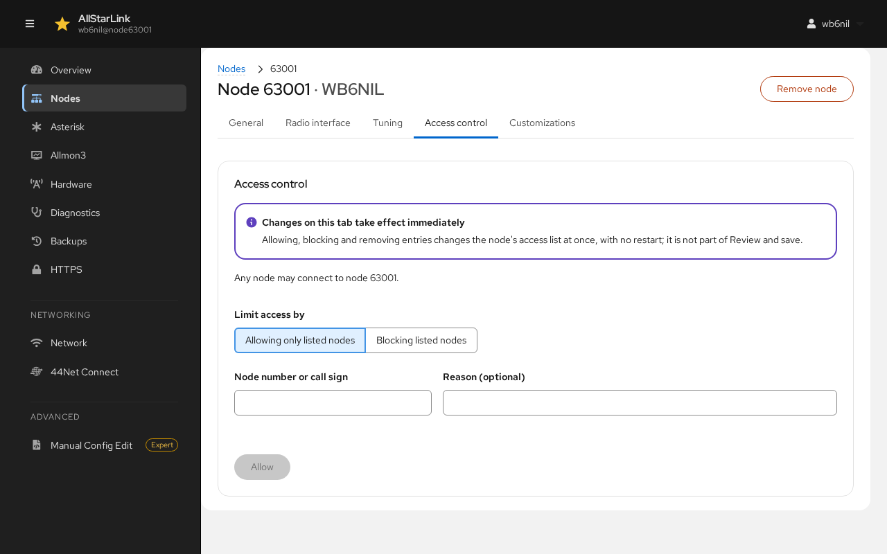
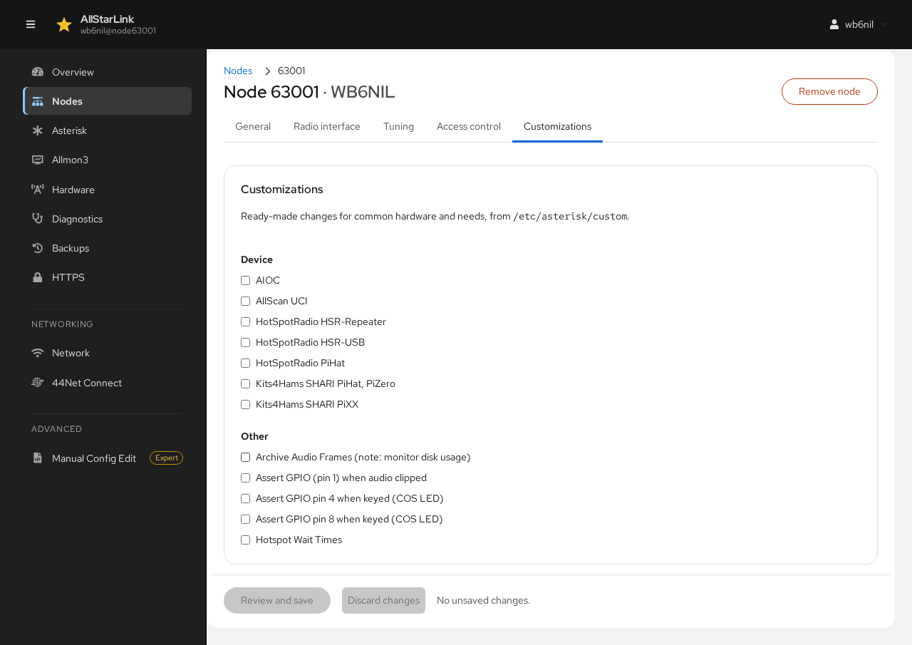

# Nodes
The **Nodes** page lists the AllStarLink nodes on the server, with each one's call sign, radio interface, duplex mode and registration state.

Click a node number to open its page. The menu (⋮) at the end of each row has **Open** and **Remove node…**:

## Adding a Node
A server can run more than one node, for example a radio node and a hub. Click **Add node** to add another one.

The wizard has the same steps as [Setting Up Your First Node](first-setup.md): node number, password, configuration, radio interface, call sign, customizations and review. Each node needs its own radio interface, unless it is a hub with no radio.

## Removing a Node
Choose **Remove node…** from the node's menu on the **Nodes** page, or click **Remove node** on the node's page. The ASL Web UI shows the changes to the configuration files before removing the node. Restart Asterisk afterwards.

## A Node's Page
A node's page has its number and call sign at the top and a tab for each group of settings:

* **General**: number, password, registration, call sign, duplex and startup connection.
* **Radio interface**: which channel driver the node uses.
* **Tuning**: levels and settings of a SimpleUSB or USBRadio interface. See [Tuning a Radio Interface](tuning.md).
* **Voter**: the voter clients, for a node using a Voter/RTCM interface.
* **Access control**: which other nodes may connect.
* **Customizations**: ready-made changes for common hardware and needs.

### Saving Changes
Changes on the **General**, **Radio interface**, **Voter** and **Customizations** tabs are kept as a draft until you save them, even if you switch between those tabs. A dot marks each tab with unsaved changes, and the bar at the bottom of the page counts them:

* **Review and save** shows the exact changes to each file. Click **Apply** to write them.
* **Discard changes** throws the draft away.

If you try to leave the page with unsaved changes, the ASL Web UI asks whether to discard them. Most saved changes need an Asterisk restart; use the banner that appears at the top of the page.

Changes on the **Tuning** and **Access control** tabs take effect immediately and are not part of **Review and save**.

## General

* **Registration** shows whether AllStarLink has accepted the node's registration.
* **Node number** renames the node. All of its settings move with it.
* **Node password** is the node's password from the [AllStarLink Portal](../basics/portal.md) (*Portal* → *Node Settings*). It shows **Unchanged** until you type a new one.
* **Registration method** is HTTP by default. **Switch to IAX registration** changes it; see [HTTP Registration](../adv-topics/httpreg.md) and [IAX Registration](../adv-topics/iaxreg.md).
* **Call sign** is used for the node's identification.
* **Duplex** sets how the node handles audio and telemetry, from `0` (half duplex, no telemetry) through `1` (hotspot) and `2` (repeater) to the full-duplex variants `3` and `4`. See `duplex` in [rpt.conf](../config/rpt_conf.md).
* **Connect at startup** can link the node to another node every time Asterisk starts.
* **Post node status** sends the node's status to stats.allstarlink.org, for the AllStarLink map and node lists.

## Radio Interface
The **Radio interface** tab chooses the Asterisk channel driver for the node:

* **SimpleUSB**: a CM1xx USB sound card without DSP (URIx, RA-40 and similar).
* **USBRadio**: the same sound cards with DSP.
* **RTCM**: a Radio Thin Client or VOTER boards. See [VOTER/RTCM](../voter/index.md).
* **No radio interface**: a hub node.
* **USRP**: a USRP connection to other software.

Changing the interface also loads the matching channel driver. The settings of the old interface are kept in case you switch back.

## Access Control
The **Access control** tab limits which nodes may connect to this node, using an allow list or a deny list. See [Allow/Deny Lists](../adv-topics/allowdenylists.md) for how this works.

* **Limit access by** chooses between **Allowing only listed nodes** and **Blocking listed nodes**.
* Enter a **Node number or call sign** and an optional **Reason**, then click **Allow** (or **Block**).

Changes on this tab take effect immediately. Allowing, blocking or removing an entry changes the node's access list at once, without restarting Asterisk.

## Customizations
The **Customizations** tab offers ready-made changes for common hardware (AIOC, AllScan UCI, HotSpotRadio, SHARI and others) and needs (archiving audio, GPIO pins for COS LEDs, hotspot wait times). They come from `/etc/asterisk/custom`.

Check or uncheck a customization, then **Review and save**.
