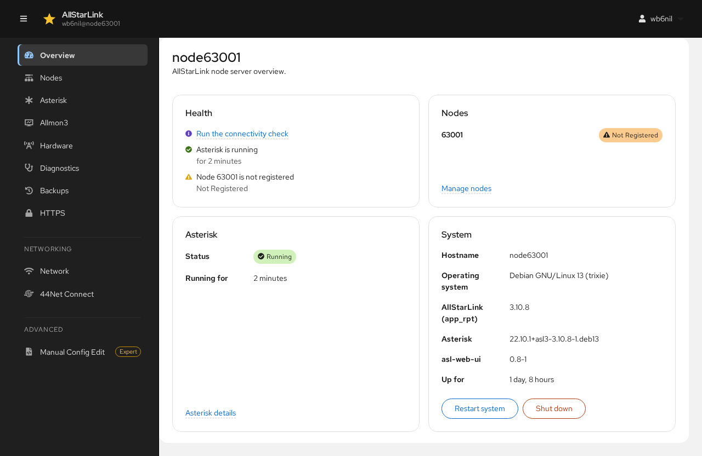

# Overview
The **Overview** page opens after you log in. It summarizes the health of the node server.

## Health
**Health** lists anything that needs attention:

* Whether Asterisk is running, and for how long.
* Whether each public node is registered with AllStarLink. A node that isn't registered can't be reached by other nodes; see [Diagnostics](diagnostics.md) to find out why.
* The result of the last [node connectivity check](diagnostics.md#node-connectivity-check), or a link to run it.

## Nodes
**Nodes** lists the nodes running on the server and their registration state. **Manage nodes** opens the [Nodes](nodes.md) page.

## Asterisk
**Asterisk** shows whether the Asterisk service is running and for how long. **Asterisk details** opens the [Asterisk](asterisk.md) page.

## System
**System** shows the host name, the operating system, the versions of AllStarLink (`app_rpt`), Asterisk and the ASL Web UI, and how long the server has been up.

* **Restart system** reboots the server.
* **Shut down** powers the server off. You need physical access to turn it back on.

Both ask for confirmation and take every node off the air.
