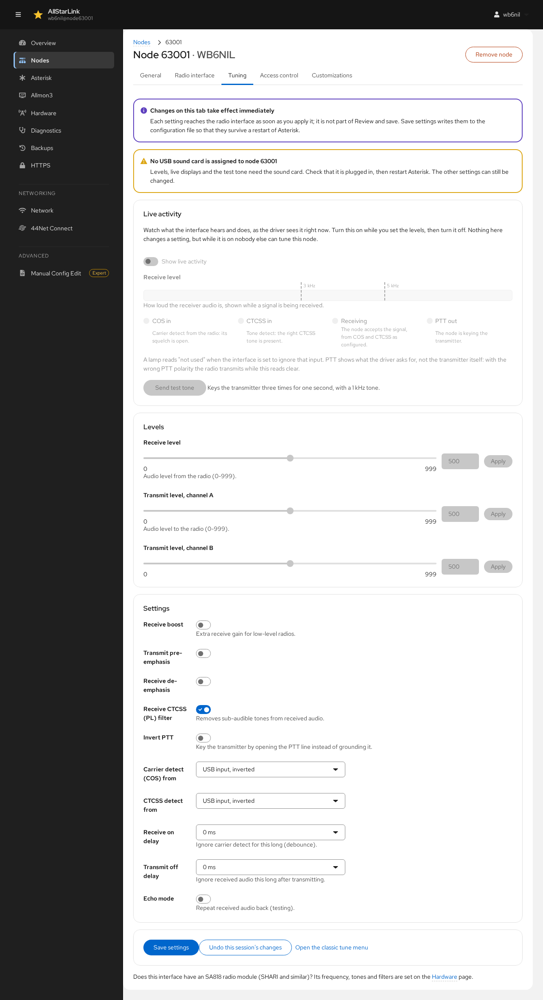

# Tuning a Radio Interface
The **Tuning** tab of a [node's page](nodes.md) sets the audio levels and signaling of a SimpleUSB or USBRadio interface. It replaces the text tune menus (`simpleusb-tune-menu` and `radio-tune-menu`) with sliders, switches and live meters. See [Audio Level Adjustment](../adv-topics/audio-level.md) for the background on setting levels.

Open **Nodes**, click the node number, then the **Tuning** tab.

!!! warning "Changes Take Effect Immediately"
    Each setting reaches the radio interface as soon as you apply it. It isn't part of **Review and save**. Click **Save settings** to write the settings to the configuration file, so that they survive an Asterisk restart.

If the USB sound card isn't plugged in or isn't assigned to the node, a warning says so. The live meters and the test tone need the sound card. The other settings can still be changed.

## Live Activity
**Live activity** shows what the interface hears and does, as the driver sees it right now. Turn on **Show live activity** while you set the levels, then turn it off again. Nothing in this section changes a setting, but while it is on, nobody else can tune this node.

* **Receive level** shows how loud the receiver audio is while a signal is being received. The markers show the 3 kHz and 5 kHz deviation points.
* **COS in** and **CTCSS in** light when the radio's carrier detect (squelch open) and tone detect inputs are active.
* **Receiving** lights when the node accepts the signal, based on the COS and CTCSS settings below.
* **PTT out** lights when the node keys the transmitter.

A lamp reads "not used" when the interface is set to ignore that input. **PTT out** shows what the driver asks for, not what the transmitter does. With the wrong PTT polarity, the radio transmits while this lamp is clear.

**Send test tone** keys the transmitter three times for one second each, with a 1 kHz tone, to set the transmit level.

## Levels
* **Receive level** sets the audio level from the radio (0–999).
* **Transmit level, channel A** and **channel B** set the audio level to the radio on each of the sound card's output channels (0–999).

Drag the slider or type a value, then click **Apply**.

## Settings
These match the settings of the text tune menu. For SimpleUSB:

* **Receive boost** adds receive gain for low-level radios.
* **Transmit pre-emphasis** and **Receive de-emphasis** apply the audio filters for radios with flat (unfiltered) audio.
* **Receive CTCSS (PL) filter** removes sub-audible tones from received audio.
* **Invert PTT** keys the transmitter by opening the PTT line instead of grounding it.
* **Carrier detect (COS) from** and **CTCSS detect from** choose where carrier and tone detection come from: **Not used**, a **USB input** or a **Parallel port** input, each normal or inverted.
* **Receive on delay** ignores carrier detect for this long (debounce).
* **Transmit off delay** ignores received audio for this long after transmitting.
* **Echo mode** repeats received audio back, for testing.

USBRadio interfaces have their own set: receive voice and squelch levels, transmit voice and CTCSS levels, the receive audio type (speaker or flat), what each transmit channel carries, and transmit pre-emphasis and limiting. They also have a **Calibration** section with guided steps for the noise, CTCSS and voice calibrations.

## Saving and Undoing
* **Save settings** writes the current settings to `simpleusb.conf` or `usbradio.conf`. A review shows what changed.
* **Undo this session's changes** puts back the settings the interface had when you opened the tab.
* **Open the classic tune menu** opens the text tune menu in a terminal, for anything this page doesn't cover.

!!! note "One Tuning Session at a Time"
    Only one person can tune an interface at a time. If someone is using the text tune menu over SSH, the page warns you.

If the interface has an SA818 radio module (SHARI and similar), its frequency, tones and filters are set on the [Hardware](hardware.md) page.
